<div align="center">

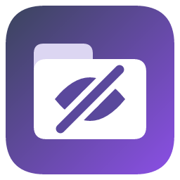

# VeilForge

### Lock or hide files and folders behind one master password.

A file and folder locker for Windows, written in **Rust**.
Pick files or folders and lock them, hide them so they cannot be found by name, or leave a stand-in that asks for your password before it opens. Nothing is encrypted or rewritten, so locking is instant and unlocking puts everything back exactly as it was.

<p>
  
  
  
  
</p>

<p>
  
  
  
  
  
  
</p>

[**Modes**](#-three-ways-to-protect) ·
[**Features**](#-features) ·
[**Screenshots**](#%EF%B8%8F-screenshots) ·
[**Download**](#-download) ·
[**What it does not protect against**](#%EF%B8%8F-what-it-does-not-protect-against) ·
[**Changelog**](CHANGELOG.md) ·
[**Developer**](#-developer)

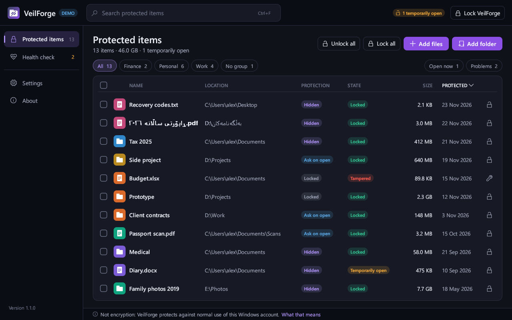

</div>

---

> [!IMPORTANT]
> **VeilForge is not encryption.** It keeps files away from normal use of your Windows account: other people at your PC, searches, and curious clicks. It does not stop an administrator, another operating system started on the same PC, or someone who removes the drive. For that, use disk encryption. See [what it does not protect against](#%EF%B8%8F-what-it-does-not-protect-against).

## 🔐 Three ways to protect

| Mode | What happens | Good for |
|---|---|---|
| **Lock** | The item stays where it is, but Windows refuses to open, list, overwrite or delete it | Keeping something visible but closed |
| **Hide** | The item is moved into a protected holding folder on the same drive under a random name. Its real name and location then appear nowhere on the disk in the clear, so it cannot be found by name in Explorer, Windows Search or tools that list every file name on the drive | Things nobody should know are there |
| **Ask on open** | The item is protected, and a stand-in with its original name and icon is left in its place. Double-click it, type the master password, and it opens. It is protected again when you close it | Files you use often |

For hidden folders, VeilForge can also scramble the names of everything inside.

## ✨ Features

<table>
<tr>
<td width="50%" valign="top">

### 🗂️ Easy to manage
- Add files and folders by button or drag and drop
- One list: name, original location, mode, state, size, date
- Unlock temporarily, unlock for good, lock all, unlock all
- Groups and search
- **Kurdish, Arabic and other right-to-left names** shown properly
- Optional **Lock / Unlock with VeilForge** in the Explorer right-click menu

</td>
<td width="50%" valign="top">

### 🔑 One master password
- Strength meter when you set it
- VeilForge locks itself after a while, when its window is closed, and when you ask
- **A hotkey that locks everything at once**, also as `VeilForge.exe --lock-now`
- Growing delay after wrong passwords, and a **wrong-password log** that tells you if someone tried while you were away
- Changing the master password asks for the current one
- An emergency sheet you can print

</td>
</tr>
<tr>
<td valign="top">

### 🛟 Built not to lose anything
- Every step is a rename or a permission change that can be undone; your files' contents are never touched
- A step-by-step journal, so a crash or power cut in the middle is recovered
- The list of protected items is stored encrypted, with rolling backups
- A recovery copy for each item is kept with the item itself
- Unlocking restores location, name, permissions, attributes and dates exactly

</td>
<td valign="top">

### 🩺 Health check and panic restore
- Checks that every protected item is where it should be, and repairs what it can
- **Panic restore:** give the master password and everything is put back, also as `VeilForge.exe --restore-all`
- The uninstaller offers to restore everything first
- Refuses to protect Windows, Program Files, your whole user profile and drive roots

</td>
</tr>
</table>

## 🖼️ Screenshots

<table>
<tr>
<td width="50%" align="center"><b>Choose how to protect</b><br>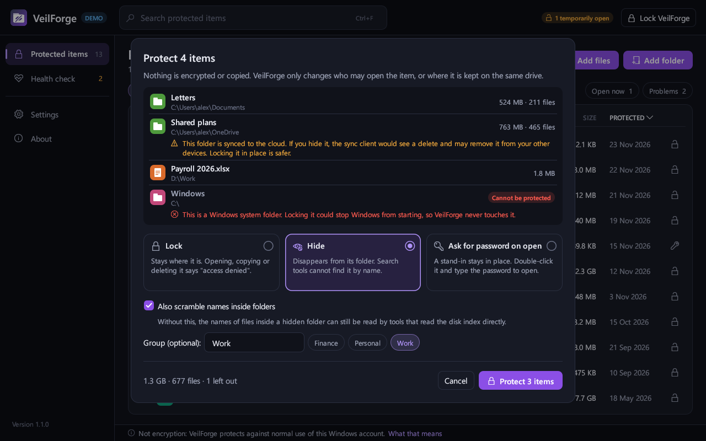</td>
<td width="50%" align="center"><b>Password prompt on open</b><br>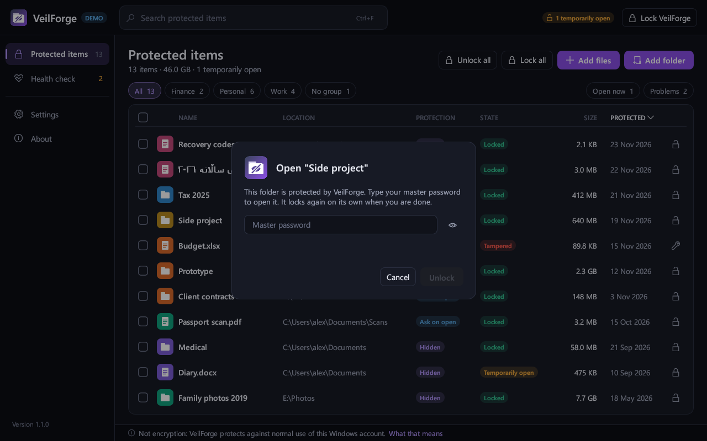</td>
</tr>
<tr>
<td width="50%" align="center"><b>Item details</b><br>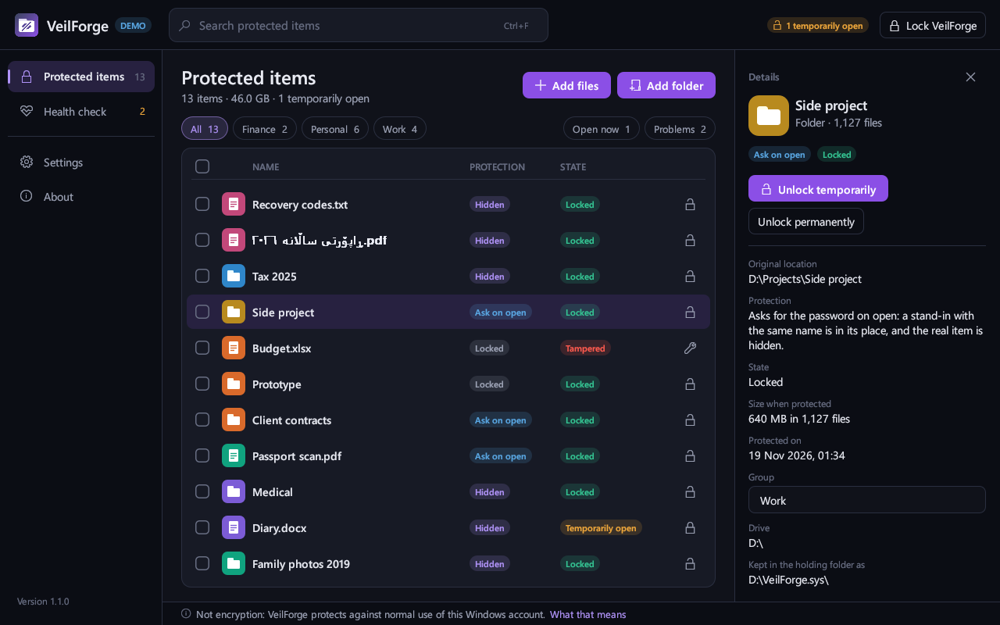</td>
<td width="50%" align="center"><b>Health check</b><br>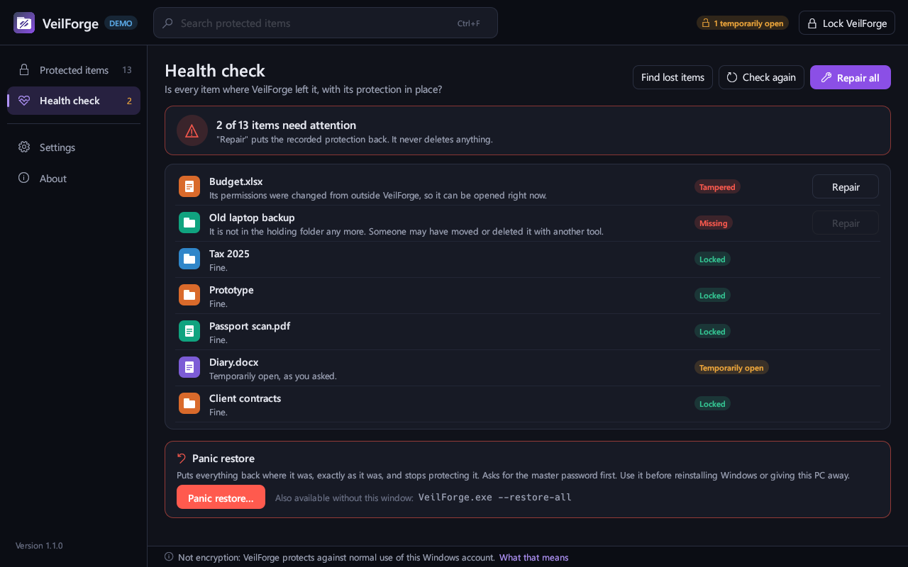</td>
</tr>
<tr>
<td width="50%" align="center"><b>Unlock VeilForge</b><br>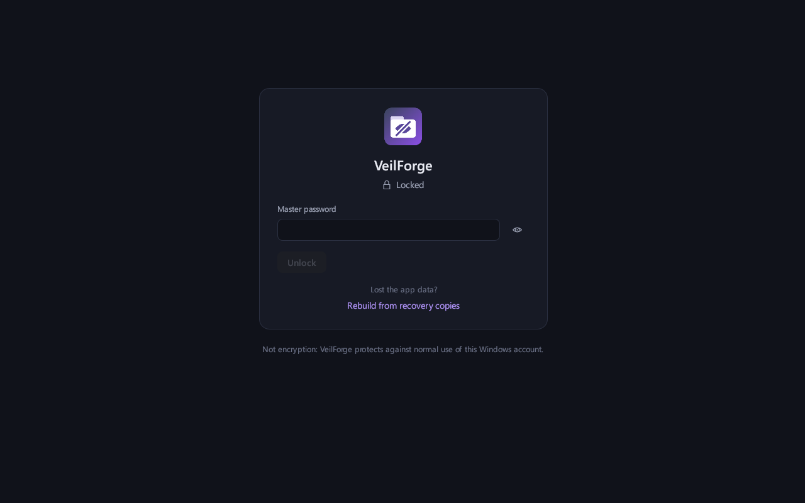</td>
<td width="50%" align="center"><b>Panic restore</b><br>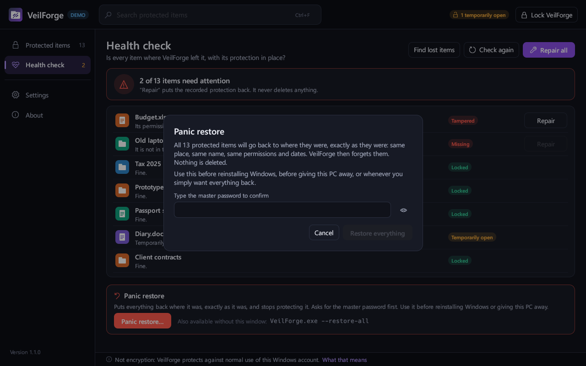</td>
</tr>
<tr>
<td width="50%" align="center"><b>Settings</b><br>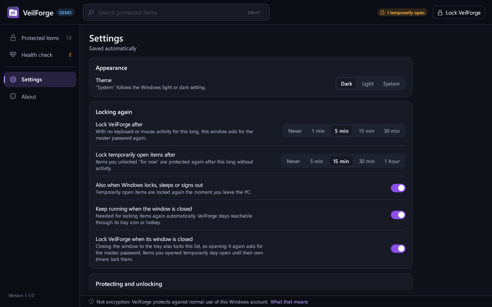</td>
<td width="50%" align="center"><b>Light theme</b><br>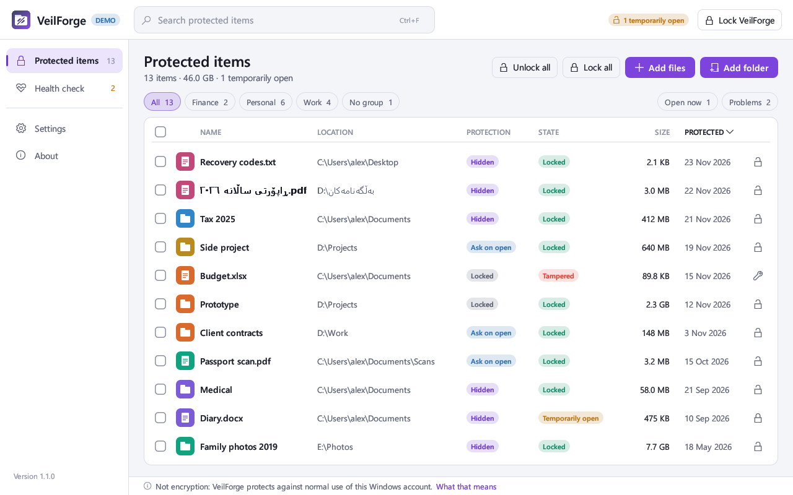</td>
</tr>
<tr>
<td width="50%" align="center"><b>Kurdish and Arabic names</b><br>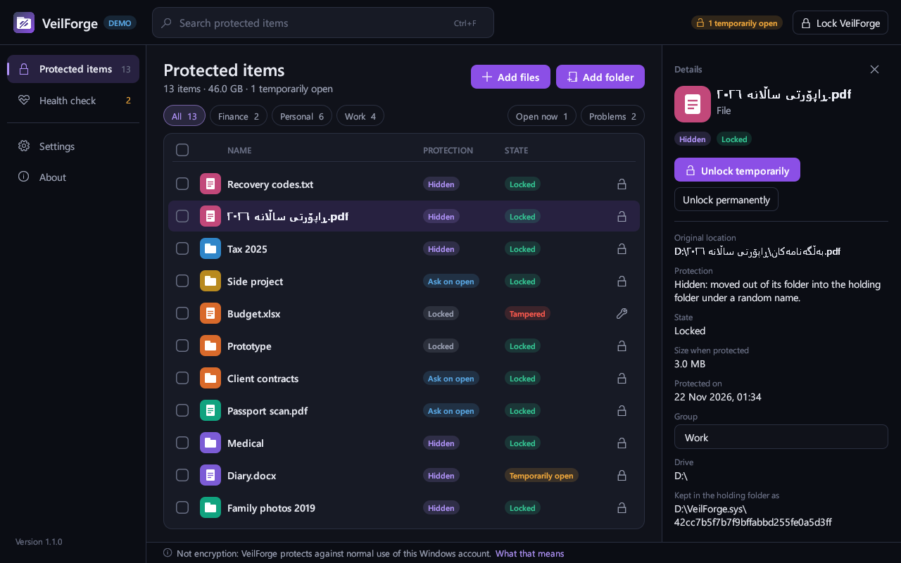</td>
<td width="50%" align="center"><b>Lock screen with an item still open</b><br>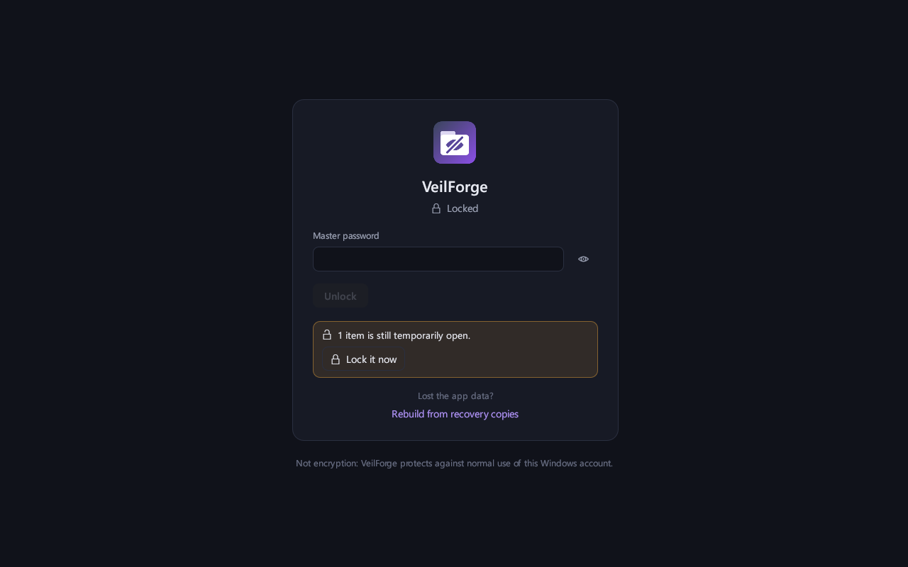</td>
</tr>
<tr>
<td width="50%" align="center"><b>Wrong passwords while you were away</b><br>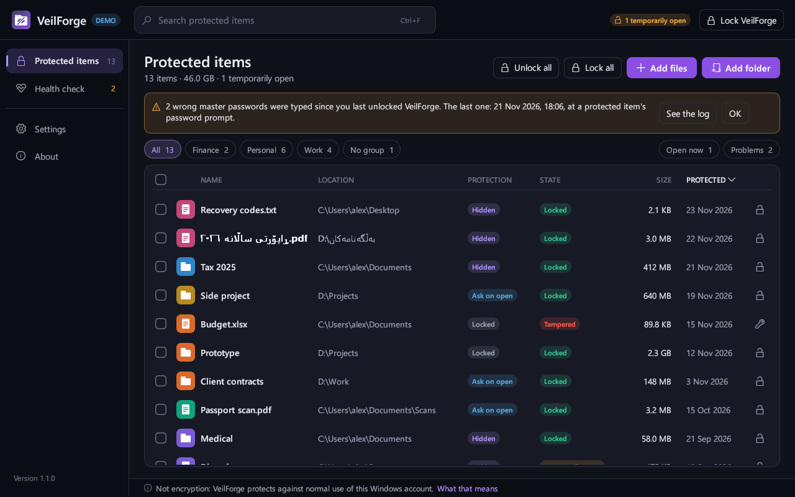</td>
<td width="50%" align="center"><b>Wrong-password log</b><br>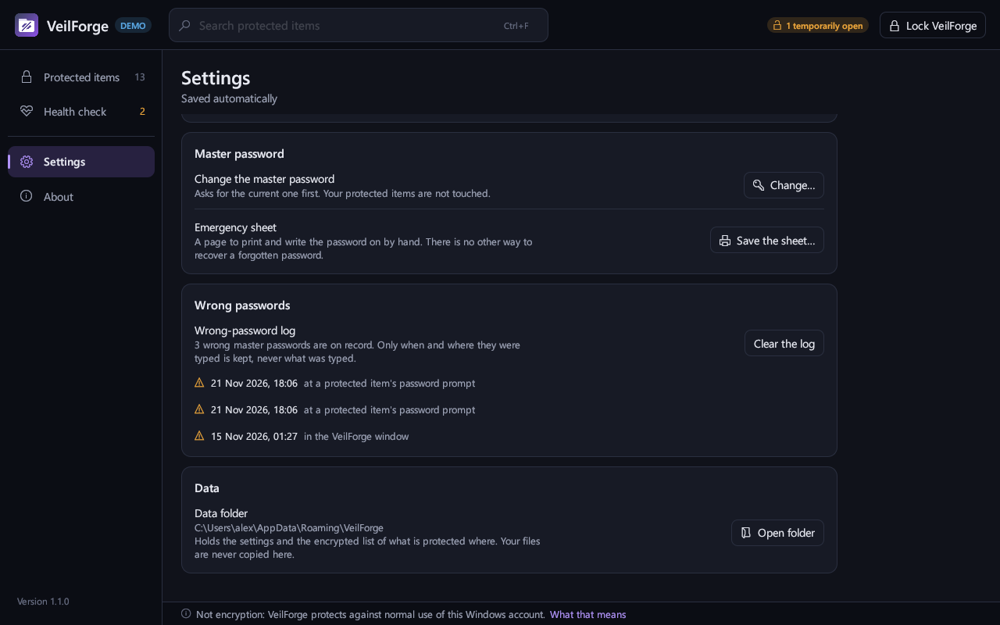</td>
</tr>
</table>

<sub>Screenshots use the built-in demo mode (<code>VeilForge.exe --demo</code>), with invented files.</sub>

## 📥 Download

Get it from the [**latest release**](https://github.com/zheerkhalid/veilforge/releases/latest):

| File | What it is |
|---|---|
| `VeilForge-Setup.exe` | Per-user installer with shortcuts, the optional right-click menu and an uninstaller |
| `VeilForge-x.y.z-portable-x64.zip` | Portable: unzip and run. The list of protected items lives next to the EXE |
| `VeilForge.exe` | The bare 7.2 MB EXE |

**There is no password recovery.** Without the master password VeilForge cannot tell which hidden item is which. Print the emergency sheet, and unlock everything before you reinstall Windows or move a drive to another PC.

> [!NOTE]
> **Version 1.1** adds a hotkey that locks everything, a wrong-password log, proper Kurdish and Arabic names and more. See the [changelog](CHANGELOG.md). Items protected with 1.0.0 stay protected and open as before.
>
> **What has been tested, and how.** The protection engine, crash recovery, the password-on-open flow and the upgrade from 1.0.0 (a folder that 1.0.0 left protected, taken over and restored by 1.1) have been tested by running them, in temporary folders. What the main window's buttons do, and locking again after idle time, on a Windows lock and on sleep, are tested by running the same code the buttons and Windows messages reach, without a person clicking. Not yet done by hand: clicking through the window with a mouse, locking or sleeping a real PC, and running the installer. Try it on copies of files first.

## ⚠️ What it does not protect against

- **Administrators** and anyone who knows how to reset a file's permissions.
- **Another operating system** started on the same PC, or the drive connected to another computer.
- **Disk tools** that read the drive directly can still read the contents; the files are not encrypted. A hidden item's original name is not on the disk in the clear, but its contents are.
- **A locked (not hidden) item can still be renamed or moved** to another folder on the same drive. It stays unreadable, and VeilForge reports it as missing. Use Hide where that matters.
- **Traces elsewhere:** backups, recent-files lists, thumbnail caches and the file system's change journal may still mention a name.
- **Ask on open** leaves a stand-in that necessarily shows the original name.
- Needs NTFS for full protection; cloud-synced and network folders get a warning, because sync clients see a hidden file as deleted.

More in [`docs/HOW-IT-WORKS.md`](docs/HOW-IT-WORKS.md).

## 🏗️ Build from source

Requires Rust (stable, MSVC toolchain) on Windows.

```powershell
git clone https://github.com/zheerkhalid/veilforge
cd veilforge
cargo build --release
# -> target\release\VeilForge.exe
cargo test
```

| Command | What it does |
|---|---|
| `VeilForge.exe --demo` | Invented items; nothing on the PC changes |
| `VeilForge.exe --restore-all` | Put everything back, after asking for the master password |
| `VeilForge.exe --lock-now` | Tell the running VeilForge to lock everything now |
| `VeilForge.exe --selftest` | Protect, check and restore generated files in a temp folder, in every mode |

The icon is drawn in code at build time. The C runtime is linked statically, so the EXE runs on a clean Windows install.

## 👨‍💻 Developer

<table>
<tr>
<td align="center" width="140">
  <a href="https://zheer.dev">
    
  </a>
</td>
<td>

**Designed and developed by [Zheer Khalid](https://zheer.dev)**

🌐 Website: **[zheer.dev](https://zheer.dev)**  
🐙 GitHub: **[@zheerkhalid](https://github.com/zheerkhalid)**  
🧩 All the Forge apps in one place: **[ForgeDock](https://github.com/zheerkhalid/forgedock)**

If VeilForge is useful to you, a ⭐ on the repo is appreciated.

</td>
</tr>
</table>

## 📄 License

MIT © 2026 [Zheer Khalid](https://zheer.dev). See [`LICENSE`](LICENSE).

<div align="center">
<sub>Built with 🦀 Rust and ❤️ by <a href="https://zheer.dev">zheer.dev</a></sub>
</div>
